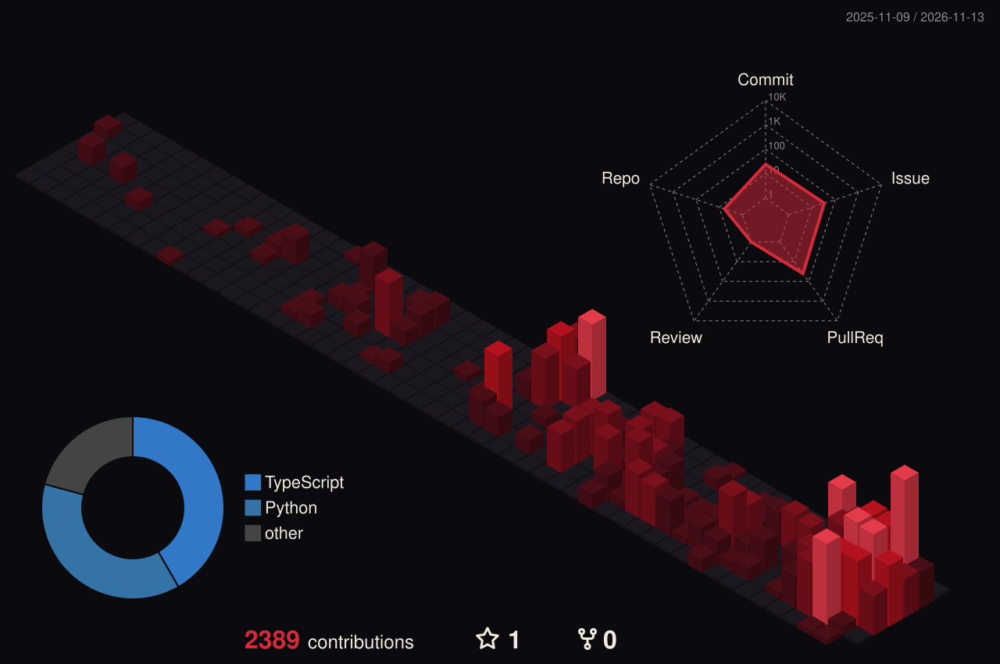

<!-- Profile README for github.com/criminaly-vicious -->

  

  
  
  

### Hi, I'm Pedro.

I'm the co-founder and CTO of **[Centra](https://centra.ia.br)**, a Brazilian edtech for socioemotional intelligence in schools. Students write short reflections, our engine **ASATA** reads them for the signals a busy adult can miss, and a human specialist reviews every signal before anything reaches the school.

I also run **[LandingLeads](https://landingleads.com.br)**, a studio that builds conversion landing pages on a monthly plan, and I'm a student at **Inteli**. Most of what I build sits where language, software and people meet.

<table>
  <tr>
    <td width="50%" valign="top">
      <strong>Building</strong> 
      The Centra platform and a new version of the ASATA engine.
    </td>
    <td width="50%" valign="top">
      <strong>Exploring</strong> 
      Small language models for Portuguese, multi-agent architectures and agentic coding with Claude Code.
    </td>
  </tr>
</table>

### Selected work

| Project | What it is | Link |
| :--- | :--- | :--- |
| **Centra** | Socioemotional screening for schools. Students write, the school receives a reviewed picture of who needs attention, and no decision is ever made by an algorithm alone. | [Website ↗](https://centra.ia.br) |
| **ASATA** | The analysis engine behind Centra: a lexical layer plus a semantic layer built on LLMs, tuned to how Brazilian teenagers actually write. | Private |
| **LandingLeads** | Conversion landing pages sold as a monthly plan, with maintenance and changes included. *Leads pousam. Negócios decolam.* | [Website ↗](https://landingleads.com.br) |
| **voice-cloner** | A Claude Code skill that learns how a person or brand writes from real samples and turns it into a reusable voice guide. | [Repository ↗](https://github.com/criminaly-vicious/voice-cloner) |
| **ctx** | A local-first CLI that turns Git history and a short, human-written project context into briefs for Claude, Cursor and Codex. | [Repository ↗](https://github.com/criminaly-vicious/Lineora) |

### How I work

- **The machine reads, a person decides.** Anything that touches a student goes through human review before it becomes an action.
- **Privacy is architecture, not a checkbox.** Student texts are pseudonymized, and schools never receive them raw, only the reviewed triage and an action plan.
- **Problems first, stack second.** Centra came out of a year of research and about fifty meetings with high schools, not out of a model looking for a use case.
- **Vision is the scarce part.** AI keeps making execution cheaper, so the edge is knowing what deserves to be built.

### Toolbox

**Product and platform**

**AI and data**

**Desktop and systems**

What I use every day sits next to what I'm still learning. The list is not a claim of equal depth.

### Contribution landscape

  

Rendered from my contribution history and refreshed daily by GitHub Actions.

### Off the clock

I spend a lot of time on philosophy of mind, the old question of what it means to understand another person, which is not far from what Centra tries to do with a paragraph a student wrote. My favorite film is *Arrival*, a story about learning a language until it changes how you think. The handle is a nod to **CRIMINALLY VICIOUS**, a music project of mine, and the playlist leans on Deftones, Type O Negative, HIM and Eagles.

### Connect

  
  
  
  
  

Seeking the incomprehensible.

