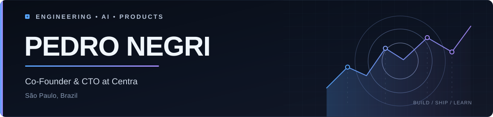
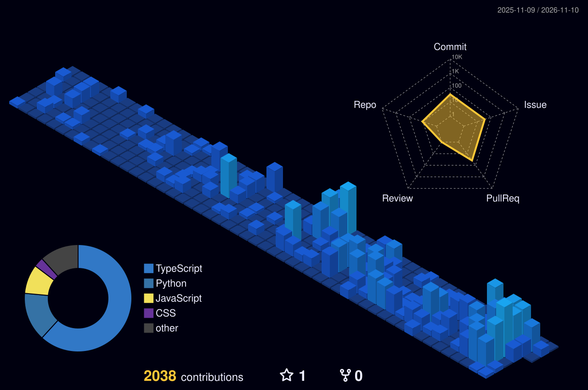

<!-- Profile README for github.com/criminaly-vicious -->

  

  
  
  

### Hello, I'm Pedro.

I'm a **software developer and Co-Founder & CTO at [Centra](https://centra.ia.br)**. I build products at the intersection of **software engineering, applied AI, and entrepreneurship**.

My work focuses on turning complex problems into practical systems. Lately, I've been exploring **language models, machine learning fundamentals, AI coding workflows, and developer tooling**.

<table>
  <tr>
    <td width="50%" valign="top">
      <strong>Building</strong> 
      AI-powered products, software platforms, and useful developer tools.
    </td>
    <td width="50%" valign="top">
      <strong>Exploring</strong> 
      LLMs, small language models, PyTorch, and systems that make developers more effective.
    </td>
  </tr>
</table>

### Selected work

| Project | What it does | Link |
| :--- | :--- | :--- |
| **Centra** | AI-assisted tools that support student well-being and school decision-making. | [Website ↗](https://centra.ia.br) |
| **ctx** | Local-first CLI that generates tailored context briefs for Claude, Cursor, and Codex from Git history and project notes. | [Repository ↗](https://github.com/criminaly-vicious/Lineora) |
| **FileFlow** | An experimental desktop file manager interface built with Electron, React, and TypeScript. | [Repository ↗](https://github.com/criminaly-vicious/FileFlow) |

### Toolbox

**Languages & foundations**

**Product & infrastructure**

**AI & experimentation**

Tech listed here reflects both professional use and ongoing learning, not claims of equal proficiency.

### Contribution landscape

  

Generated from my GitHub contribution history and refreshed daily with GitHub Actions.

### Connect

  
  
  
  

Build things that matter. Keep learning.
